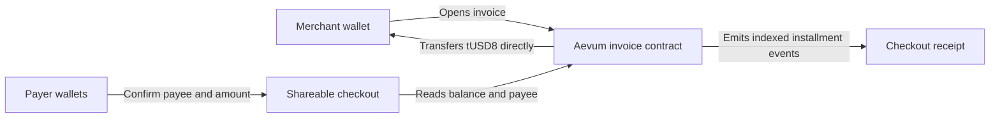

# Aevum Balance

A single invoice can be paid in installments by multiple wallets. Aevum Balance gives the merchant one checkout link and an on-chain receipt, while tUSD8 moves directly from each payer to the merchant.

This is a fresh Solidity and browser implementation for PQA Labs’ Aevum Builder Challenge #1. It carries forward the installment idea from [BalanceDue](https://github.com/AjnasNB/balancedue), which used a separate NEAR workflow and off-chain invoice state. [Challenge rules](https://qday.io/builder-challenge)

## Try it from source

Requires Node.js 22 or newer. The contract and browser QA run against local EVM fixtures.

```sh
npm ci
npm test
npm run build
npx playwright-core install chromium
npm run test:browser
```

The browser QA opens an invoice, reloads its link as two separate wallets, pays 0.4 and 0.6, and verifies the zero balance and two receipt entries. Set `DEMO_CAPTURE=1` to save a local rehearsal video and screenshot under `.local/recording/`.

## Deploy on Aevum

- Network is QDay Aevum Testnet, chain ID `44005`, with tQDAY for gas. [Network reference](https://wiki.qday.info/guide/start/add-network)
- Settlement token is tUSD8 at `0x456569838f1d43009A91ebA4263147Afd7233483`, with six decimals. [Challenge token](https://qday.io/builder-challenge)
- The merchant needs gas. Two separate payers each need gas and enough tUSD8 for their installment. Use only testnet-specific wallets and store their keys locally. [Faucet](https://faucet.qday.info/en)

Copy `.env.example` to a git-ignored `.env` file and fill in the three testnet keys. The deploy script checks the chain and token metadata before submitting and records the address and deploy hash in `src/deployment.json`.

```sh
node --env-file=.env scripts/aevum-flow.mjs --balances-only
node --env-file=.env scripts/deploy.mjs
node --env-file=.env scripts/aevum-flow.mjs
npm run dev
```

For explorer source verification, submit the contract source and its constructor argument with Solidity 0.8.39, Paris target and optimizer enabled at 200 runs. Use the recorded deploy transaction to match the contract address. [Aevum Explorer](https://explorer-test.qday.info)

The live smoke test writes a receipt to `.local/aevum-evidence.json`. The same invoice ID opens in the browser via `?invoice=<id>`. For a portable demo after deployment, run the packaged web app.

```sh
docker build -t aevum-balance .
docker run --rm -p 8080:80 aevum-balance
```

**Deployment status** · Local contract and browser paths use fixtures. Public Aevum deployment and live receipts require valid RPC TLS and funded test wallets. [Submission checklist](docs/submission.md)

## Architecture



The contract records the payee from the merchant's own signing wallet and makes it immutable for the invoice. Each payment supplies the expected payee, rejects an amount above the current remainder, and updates the invoice only if the token transfer succeeds. The UI shows the full payee address and requests wallet approval for the installment amount. Payment attempts never count as installments until the receipt confirms them. The service holds no stablecoins, and the share link contains only an invoice number. Invoice metadata and payments are public on the test chain.

Solidity and solc compile the contract. Viem handles wallet actions and typed chain calls. Vite builds the browser app. Ganache and Playwright provide isolated tests and are excluded from the served application. Dependency licenses are MIT (Viem, Vite, Ganache and the solc-js wrapper), GPL-3.0 (the Solidity compiler), and Apache-2.0 (Playwright). Application code uses MIT. The prototype targets the challenge token and has no refunds, merchant identity attestation or mainnet mode.
